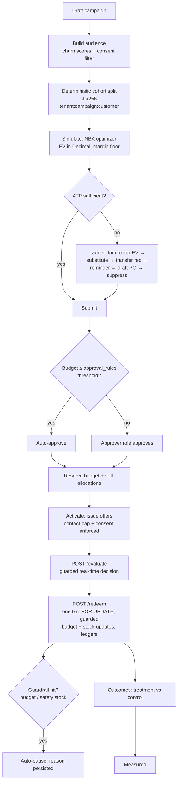

# Retention & Commercial Orchestration

Closed-loop retention decisioning: churn risk → next-best action → pricing/margin
policy → inventory → procurement → budget → approval → activation → real-time
offers → atomic redemption → treatment-vs-control measurement.

> **All customer data, purchase histories, treatment assignments and outcomes in
> this module are SYNTHETIC** (deterministically generated, `is_synthetic=true`,
> archetype-labelled). No production accuracy or causal effect is claimed.

## Gap analysis (repository audit, 2026-07-20)

Already existed and was **reused, not duplicated**:

| Concept | Reused from |
|---|---|
| Suppliers, unit cost, MOQ, lead time | `suppliers` / `product_suppliers` (migration 016) |
| Purchase orders + PO state machine | `purchase_orders` (+ `procurement_service`) |
| Approval threshold config | `approval_rules` (migration 019) |
| Inventory truth, reservations, stock ledger | `inventory`, `inventory_transactions` (migration 002) |
| Inter-store transfers | `stock_transfers` (recommend-only in this module) |
| Price / effective-dated cost | `items.unit_price_aed` (005), `item_costs` + `unit_cost_aed` (058) |
| Audit-event pattern | mirrors `procurement_events` (022) |
| Tenant scoping + RLS | `tenant_isolation` policy pattern (010–012) |
| Role/store scoping | `auth_deps.get_current_user` / `get_accessible_store_ids` |
| Notifications | `publish_alert` → existing `alerts:stream` SSE |

Genuinely missing → added in migration **074**: `customers`,
`customer_purchases`, `retention_campaigns`, `campaign_offers`,
`campaign_allocations`, `retention_budget_ledger`, `retention_events`
(all tenant-scoped, all under RLS).

## Workflow

## Campaign state machine

`draft → audience_ready → simulated → pending_approval → approved → active ⇄
paused → completed → measured`; `cancelled` from any pre-completion state.
Transitions are validated by `retention_service.STATUS_TRANSITIONS` — there is
no arbitrary status write. The spec's four `PENDING_*` review states are
collapsed into `pending_approval` for slice 1: approval need is
threshold-driven (reusing `approval_rules`), and procurement review happens on
the linked draft PO inside the existing procurement module.

## Money & inventory invariants

- All money is `NUMERIC` in Postgres and `Decimal` in Python. Floats never hold money.
- `retention_budget_ledger` is append-only with before/after balances for every
  reserve / release / spend.
- DB-level `CHECK`: `budget_spent_aed <= discount_budget_aed`,
  `consumed_units <= allocated_units`, non-negative amounts.
- Redemption is **one transaction**: idempotency-key replay check → offer
  `FOR UPDATE` → campaign `FOR UPDATE` → margin-floor validation → guarded
  budget `UPDATE … WHERE spend+amt <= budget` → guarded inventory
  `UPDATE … WHERE current_stock >= qty` → `inventory_transactions` entry →
  ledger entry → audit event → auto-pause guardrails → commit. A failed guard
  raises and rolls the whole transaction back; inventory can never go negative
  and spend can never exceed budget, including under concurrency
  (row locks + guarded updates + `UNIQUE(tenant_id, redemption_key)`).
- Redis/SSE is notification only (via the existing `alerts:stream`); Postgres
  is the financial record. A post-commit publish failure loses a toast, never money.

## Churn model (honest)

`churn_heuristic_v1` — a deterministic logistic-form scorer with fixed,
documented coefficients over behavioural features only (recency vs the
customer's own purchase rhythm, 90-day frequency, promo dependency, return
ratio). Label definition: *churn = no purchase within 45 days after the scoring
date, for customers active in the prior 90 days* (leak-free by construction).
Reason codes are emitted per score. `GET /api/retention/model` returns the
model card. No trained artifact exists yet; nothing claims trained-model
accuracy. `scikit-learn`/`lightgbm` are already pinned — a trained, calibrated
baseline with PR-AUC/ROC-AUC/Brier reporting is the designated next step and
slots in behind the same scoring interface.

Sensitive attributes (gender, ethnicity, religion, nationality) do not exist in
the schema and are never decision features.

## Next-best-action optimizer

Typed candidates: `NO_ACTION`, `REMINDER`, `PERCENT_DISCOUNT` (5 / 10 / max),
`SUBSTITUTE_PRODUCT`. Per candidate:
`EV = churn × retention_lift × response × monthly_value + response × unit_margin
− response × discount_cost − communication_cost` (Decimal). Constraints: max
discount, minimum margin % (discounting is refused outright when unit cost is
unknown), campaign budget, ATP, consent, contact-frequency cap, control cohort.
Highest positive EV wins; **high churn alone never triggers a discount**. Every
decision persists its price/cost snapshot, scores, EV and reason codes on
`campaign_offers`, so it is reproducible after prices change.

## API

All under `/api/retention` (registered in `routes/registry.py`):

- `POST /campaigns`, `GET /campaigns`, `GET /campaigns/{id}`
- `POST /campaigns/{id}/audience | simulate | submit | approve | activate |
  pause | resume | complete | cancel`
- `GET /campaigns/{id}/offers` (decision trace), `GET /campaigns/{id}/outcomes`
- `POST /evaluate` — real-time next-best action (always safe `NO_ACTION` + reason codes on any failed guard)
- `POST /redeem` — idempotent atomic redemption (`idempotency_key` required; replay returns the original result)
- `GET /customers` (synthetic-labelled), `GET /model` (model card)

Permissions: marketing mutations need `can_manage_promotions` (or admin);
approval needs `super_admin`/`regional_manager` (finance-approver stand-in in
the current role set); store access follows `can_access_store` everywhere.

## Assumptions (recorded per spec)

1. Existing roles stand in for the marketing/finance role split; adding new
   RBAC roles is deferred (config-driven approval chains ride on `approval_rules`).
2. One store + one item per campaign in slice 1 — the ladder, ledger and state
   machine generalize; multi-scope is additive.
3. Transfers are *recommended* (surfaced in simulation), not auto-created — the
   inventory module owns `stock_transfers`.
4. The transactional outbox is satisfied by the in-transaction
   `retention_events`/ledger rows (durable record) + post-commit best-effort
   publish; a polling dispatcher is deferred until an external consumer needs it.
5. Frontend is a single coherent `/retention` journey (list → studio → trace →
   outcomes) rather than seven separate pages; EN/AR nav keys added, primitives
   inherit the existing RTL/keyboard/reduced-motion support.

## Testing

`backend/tests/test_retention.py` (17 tests, all passing): state-machine
legality (incl. rejected-approval-cannot-activate), cohort stability & split
accuracy, churn-score monotonicity + reason codes, EV Decimal math, margin
floor, unknown-cost refusal, negative-EV suppression, idempotent replay with
zero writes, expired-offer rejection, model-card honesty. Concurrency
invariants are enforced in SQL (locks + guarded updates + constraints) and are
exercised against the live stack, not mocks.

## Deferred (priority order)

1. Trained calibrated churn baseline + metrics endpoint upgrade (sklearn already pinned).
2. T-learner uplift baseline on synthetic randomized treatment history (AUUC/Qini).
3. Multi-store / multi-item campaigns; per-item allocation on substitutes.
4. Config-driven multi-step approval chains (parallel finance + procurement).
5. Dedicated `retention:stream` SSE channel if the alerts stream proves too coarse.
6. Nightly jobs: offer expiry sweep, contact-counter reset, auto-complete at `ends_on`.
