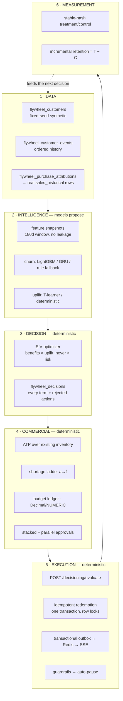

# Flywheel — Retention & Commercial Orchestration

**Flywheel** () is Arabic for *the loop*. The name is the thesis: retention only
works when the loop closes — churn risk → offer decision → stock → budget →
approval → live execution → measured lift → back into the next decision.

**Tagline:** *the retention loop that pays for itself.*

> **All customers, treatment histories and campaign outcomes are synthetic.**
> No production accuracy is claimed. See [`model_card.md`](model_card.md).

---

## The governing rule

> **Models propose. Only deterministic, policy-checked services touch money or stock.**

`optimizer.py` contains no model. `churn.py` writes to no financial table. Every
dirham and every unit moves through a row-locked service transaction with an
audit trail and an idempotency key.

## Documents

| Document | What it covers |
|---|---|
| [`00_gap_analysis.md`](00_gap_analysis.md) | The repository audit: what existed, what Flywheel reuses vs adds, and every recorded assumption |
| [`model_card.md`](model_card.md) | Churn + uplift models, the honest DL framing, features, leakage control, fairness, metrics, limitations |
| [`state_machine.md`](state_machine.md) | The campaign lifecycle, generated from the enforced graph |
| [`architecture_blueprint.html`](architecture_blueprint.html) | One-page, offline, printable stakeholder blueprint |

## Architecture at a glance



## What Flywheel reuses rather than forks

Flywheel **extends** Retail Intelligence; it does not shadow it.

| Concern | Reused |
|---|---|
| Stock truth | `inventory`, `inventory_transactions` — Flywheel adds an allocation layer *on top*, never a parallel stock table |
| Procurement | `suppliers`, `product_suppliers`, `purchase_orders`, `stock_transfers` |
| Cost & price | `item_costs` (effective-dated), `items.unit_price_aed` |
| Auth | `app/auth_deps.py` — no parallel authorization |
| Tenancy | `current_tenant_id()` + FORCE RLS, identical to migrations 012/060 |
| SSE | The existing stream-ticket pattern and `useEventStream` hook |
| Audit | `audit_log` |

`tests/test_flywheel_migration.py` enforces this: it fails if a `flywheel_inventory`
or `flywheel_sales` table appears, or if 074 alters a shared table.

## Quick start

```bash
docker compose up -d          # migration 075 auto-applies on startup

# In the UI: Flywheel → "Generate customers & score risk"
# Or by API:
curl -X POST localhost:8000/api/flywheel/seed           -d '{"customer_count":600}'
curl -X POST localhost:8000/api/flywheel/features/build
curl -X POST localhost:8000/api/flywheel/churn/score

# Train and compare the models (LightGBM vs GRU vs FT-Transformer vs T-learner)
docker exec sales_backend python scripts/flywheel_train.py --tenant 1 --models all
```

## Demo script — the full loop in 12 minutes

Logins (password `Demo@2026!`): `atharva@retaildemo.app` (super_admin),
`krishna@retaildemo.app` (regional_manager, Dubai), `yash@retaildemo.app`
(store_manager, Al Barsha).

1. **Set up** — sign in as `atharva`, open **Flywheel**, click *Generate customers
   & score risk*. 600 synthetic customers across ten archetypes, feature snapshots
   built, churn scored. Note the loop ring: nothing is running yet.
2. **See the risk** — **Customers at risk**. Filter to `critical`. Pick one and read
   *Why*: the drivers are stated in plain language ("overdue against their own
   buying rhythm"), not as a bare score.
3. **Ask for a decision** — hit **Evaluate**. You get an action, its EIV, and every
   alternative that was considered and refused with a reason. Do this on a
   `promotion_resistant` customer too: the answer will be `NO_ACTION` or a
   reminder, because uplift is near zero even though risk is real. **This is the
   product's central claim, made visible.**
4. **Build a campaign** — **Campaign Studio**. Name it, set max discount 20%, margin
   floor 10%, budget 25,000 AED, control group 20%. Create the draft.
5. **Audience** — churn floor 0.3, max 2,000. Watch the treatment/control split;
   the control share is fixed by a stable hash and will be identical if you rebuild.
6. **Simulate** — three scenarios, the action mix, and any SKU where stock is
   short, each with the ladder rung Flywheel would use to resolve it (reduce
   audience → substitute → transfer → non-stock reward → procurement → suppress).
7. **Submit** — the approval chain is sized from *this campaign's* exposure. Note
   the parallel stage: Inventory and Procurement review side by side.
8. **Approve** — **Approval inbox**. As `krishna` you can act on the marketing and
   inventory steps; the finance step shows *"you cannot act on this step"* with the
   role that can. Sign in as `atharva` to clear finance.
9. **Activate** — open the campaign. Activation reserves budget and places soft
   allocations **in the same transaction** as the state change. Check
   **Budget & exposure**: a `RESERVED` ledger entry has appeared with its before
   and after balance.
10. **Redeem** — `POST /api/flywheel/decisioning/redeem` with an offer code and an
    idempotency key. Stock decrements, reserved budget converts to spent, the
    ledger records it, and the live page updates over SSE.
11. **Prove idempotency** — send the *exact same request again*. You get the
    original redemption back, `"replayed": true`, and **nothing changes twice**.
12. **Trip a guardrail** — redeem until burn passes 95% of the reserved exposure.
    The campaign auto-pauses with a recorded reason and `actor_kind='guardrail'`
    in its history. Try to resume: it refuses while the breach stands.
13. **Measure** — complete the campaign, then **Measure lift**. Treatment vs
    control retention, the incremental difference, cost per retained customer,
    and — if the control arm is small — an explicit warning that the number is
    directional only.
14. **Audit** — open any **Decision Trace**. Every EIV term, the price/cost
    snapshot, the ATP arithmetic, the model version, the policy version, and a
    **replay** that recomputes EIV from the stored terms and confirms it matches.

## API surface

30 endpoints under `/api/flywheel` (Swagger: `localhost:8000/docs`, tag *Flywheel*),
plus `GET /stream/flywheel` for the live feed. Highlights:

| Endpoint | Purpose |
|---|---|
| `POST /decisioning/evaluate` | Real-time next-best action. Never raises on a policy refusal — `NO_ACTION` with reason codes is a valid answer |
| `POST /decisioning/redeem` | Atomic, idempotent redemption |
| `GET /decisions/{id}` | Full trace + reproducibility replay |
| `GET /campaigns/{id}/live` | Live control centre metrics + guardrail state |
| `POST /campaigns/{id}/measure` | Treatment vs control |
| `GET /budget` | Ledger, balances, cash requirement by date |

## Testing

```bash
docker exec sales_backend python -m pytest tests/test_flywheel_decisioning.py tests/test_flywheel_migration.py -v
```

149 tests covering the policy gates (risk alone never buys a discount, negative
uplift refused, margin floor, stock refusal), EIV arithmetic and replay, the
state machine, stable treatment/control assignment, the churn and uplift model
shapes, Qini, and every schema invariant in migration 075.
