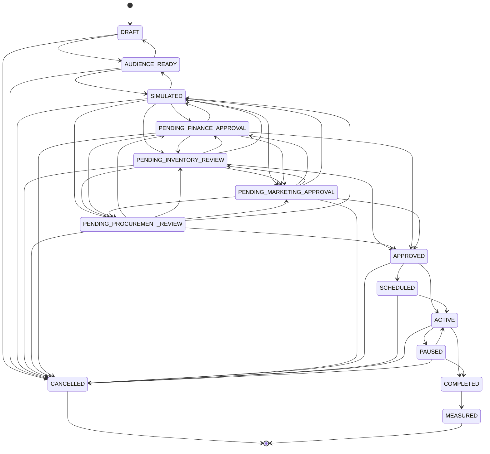

# Flywheel — Campaign State Machine

The campaign lifecycle is **persisted, service-validated and append-only**.
Transitions are enforced by `backend/app/services/flywheel/campaign_state.py`; the
`CHECK` constraint in migration 075 only constrains the value *set*, never the
legality of a jump.

> The diagram below is **generated from the live `TRANSITIONS` graph** by
> `campaign_state.mermaid_diagram()`, and `tests/test_flywheel_decisioning.py`
> asserts on its content — so it cannot drift from the rules actually enforced.

## The graph

## Design decisions worth keeping

**The four review states are siblings, not a queue.** The approval engine decides
which are required from the campaign's actual exposure, and steps sharing a
`step_order` complete in **parallel**. Inventory review and procurement review
both follow simulation, and neither waits on the other.

**`CANCELLED` is reachable from every non-terminal state.** An operator must
always be able to stop a campaign, and cancelling releases the budget
reservations and inventory allocations it was holding.

**`PAUSED ⇄ ACTIVE` is a two-way edge.** Guardrails pause; a human resumes — but
`POST /campaigns/{id}/resume` re-runs the guardrail check first and refuses if
the breach that caused the pause is unresolved. Otherwise resuming would just
trigger another pause on the next redemption.

**Approval states can fall back to `SIMULATED`.** A `changes_requested` decision
returns the campaign to a workable state rather than killing it.

**`MEASURED` is the only exit from `COMPLETED`.** Measurement is what closes the
Flywheel loop and feeds stage 6 back into stage 1, so a campaign is not "done" until
its true lift has been computed.

**`activated_at` is written once.** Resuming from `PAUSED` must not rewrite when
the campaign went live, or the audit trail loses the original activation.

## Concurrency

`campaign_state.transition()` takes `SELECT ... FOR UPDATE` on the campaign row
before validating. Without it, two concurrent transitions could both read the
same `from` state and both believe themselves legal — the classic lost update
that would let a campaign be approved and cancelled at the same instant.

It does **not** commit. Callers compose it into their own transaction, so
activation reserves budget *and* transitions atomically: either both happen or
neither does, and a campaign can never be live-but-unfunded.

## Every transition is recorded

`flywheel_campaign_transitions` stores `from_status`, `to_status`, `actor_user_id`,
`actor_kind` (`user` / `system` / `guardrail`), `reason` and `request_id`. The
`actor_kind` distinction is what lets the UI show "auto-paused by a guardrail"
differently from "paused by Krishna", which is the first question anyone asks
when a campaign stops.

## Proof-carrying statuses

Migration 075 enforces two claims at the database level, so not even a buggy
writer can record a status without its evidence:

- `flywheel_campaign_paused_has_reason` — `PAUSED` requires `pause_reason`
- `flywheel_campaign_active_has_timestamp` — `ACTIVE`/`COMPLETED`/`MEASURED`
  require `activated_at`
