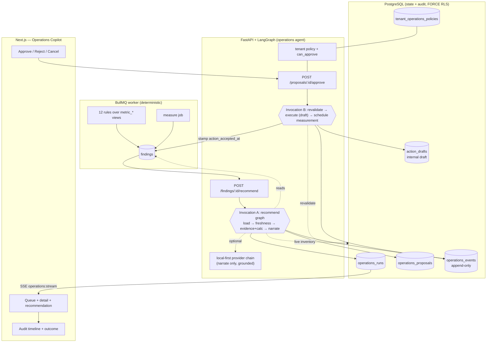

# Retail IQ Operations Copilot

A human-in-the-loop operations agent that turns a verified diagnostic finding into
an **evidence-backed diagnosis**, a **structured recommended action**, a
**human-approved draft**, an **auditable execution**, and a **measured outcome**.

It extends the existing deterministic diagnostics loop — it does not replace it,
and it never lets an LLM guess a number a decision depends on.

---

## The problem

Retail IQ already *detects* problems (a stockout, a revenue drop, a return spike)
and can *measure* whether they recover. Between detection and measurement sat a
human doing undocumented work: pulling the current numbers, deciding what to do,
sizing the order, getting sign-off, and remembering to check later. The Operations
Copilot makes that middle explicit, safe, and auditable — without pretending to
have authority it does not have.

## User roles

| Role | In the copilot |
|---|---|
| **Store manager** | Sees findings for accessible stores; may approve **investigation tasks** in scope. |
| **Regional manager** | May approve **replenishment** and **stock-transfer** drafts within their region (both stores must be in scope for a transfer). |
| **Super admin** | May configure the tenant operations policy and approve high-impact drafts. |
| **Analyst** | Read-only. Never approves. |

Approval authority is **tenant-configurable policy**, not hard-coded — the table
above is the shipped default (`services/operations/policy.py`).

## The workflow

```
DETECT → AUTHORIZE → COLLECT EVIDENCE → DIAGNOSE → RECOMMEND → VALIDATE
      → REQUEST HUMAN APPROVAL → EXECUTE APPROVED ACTION → MEASURE → RESOLVE/ESCALATE
```

- **Detect** is the existing BullMQ worker (12 deterministic rules → `findings`).
- **Authorize → Recommend** is *invocation A* of the agent graph. It runs to an
  `awaiting_approval` proposal and **stops** — no web request is held open.
- **Approve → Execute → Measure** is *invocation B*, resumed by `run_id` after a
  human decides. It revalidates against live data, writes an **internal draft**,
  and hands the finding to the existing measure loop.

### Three MVP use cases

1. **Inventory replenishment draft** — a stockout/velocity finding → recompute
   days of cover → size an order-up-to quantity → draft (no supplier selected if
   none is connected) → regional-manager approval → internal procurement draft →
   measure whether cover recovered.
2. **Stock transfer recommendation** — a store at risk while a sibling in the same
   region is overstocked → size a transfer that **protects the source store's**
   safety cover → regional-manager approval → revalidate immediately before
   execution (abort + re-approve if inventory moved) → internal transfer task.
3. **Operational investigation task** — a revenue/category/return finding →
   separate **measured facts from labelled hypotheses** → a bounded checklist →
   store-manager approval → assigned task with a due date → track KPI recovery.

## Safety model (non-negotiable)

- **No external order without human approval.** Execution is **draft-only**: a
  code-side connector registry (empty today) gates real execution, so no tenant
  configuration can submit to a supplier or warehouse. Execution writes an
  internal `action_drafts` row, clearly labelled.
- **Every number is deterministic.** Quantities and impact come from pure
  functions over structured data. The LLM writes prose and is treated as
  untrusted input: a mechanical grounding check rejects any figure it introduces
  that the evidence does not support, falling back to the deterministic template.
- **Refuse under uncertainty.** Missing, stale, or insufficient evidence, a
  finding already resolved, or confidence below the tenant floor → a **refusal or
  escalation**, never an invented recommendation.
- **Scope is server-verified.** `tenant_id`, role, and accessible stores come only
  from the authenticated session — never from a request body or model output.
  Checked at recommend, approval, and execution.
- **Idempotent and concurrency-safe.** Approvals carry the version they saw
  (optimistic concurrency); a stale or racing decision is rejected. A retried
  approval/execution with the same idempotency key is a no-op.
- **Revalidated before execution.** The key quantity is recomputed against live
  inventory; if it moved past the tenant tolerance the proposal is *superseded*
  and fresh approval is required.
- **Immutable audit.** Every transition is an append-only `operations_events`
  row; UPDATE/DELETE are revoked at the database and the log cannot be erased by
  deleting a parent (NO-ACTION foreign keys). FORCE row-level security on every
  table; intra-module foreign keys are tenant-composite.
- **Degrades safely without the LLM** — the deterministic path produces the whole
  recommendation on its own.

## Architecture



**Responsibility split** (unchanged from the existing boundary):
- **BullMQ worker** — deterministic detection and scheduled measurement.
- **FastAPI + LangGraph** — evidence gathering, diagnosis, proposal generation,
  validation, approval orchestration, draft execution.
- **PostgreSQL** — runs, proposals, approvals, audit, policy; measurement via the
  existing `findings` columns.
- **Redis** — the `operations:stream` channel for live UI updates.
- **Next.js** — queue, evidence, approvals, audit timeline, outcome.

## Current limitations (honest pilot-readiness)

This is a **demonstrable MVP on synthetic data**, not a production deployment.

- **"Execution" is an internal draft, not a real order.** No POS/ERP/procurement/
  warehouse connector exists. A replenishment produces an internal draft with **no
  supplier selected**; a transfer produces an internal task. Nothing leaves the
  building. Wiring a real connector is scoped in `PILOT_INTEGRATION_CHECKLIST.md`.
- **Inventory is seeded/derived, not POS-fed**, and carries no observation
  timestamp — so the freshness gate protects the *finding*, not the stock number.
  A real inventory feed with timestamps closes this.
- **Returns have no reason codes** (returns are negative-unit sales), so an
  investigation into a return spike can reference the metric but not a cause.
- **Measurement is the finding's own metric re-checked** by the existing worker
  loop over a window — not a per-execution controlled experiment.
- **No financial-savings claim is displayed.** Outcomes are shown as measured
  operational change (e.g. days-of-cover recovery), never an invented "AED saved".

## Future integrations

See `PILOT_INTEGRATION_CHECKLIST.md`. In priority order: a real inventory source
of truth (with timestamps), a procurement/PO connector, a stock-transfer/warehouse
connector, returns with reason codes, and supplier master data. Each plugs into the
connector interface; until a connector is implemented **and** contracted, its
action stays draft-only — by design.

## Where the code lives

- `backend/app/services/operations/` — `contracts.py` (the output contract +
  grounding check), `policy.py` (tenant policy + approval engine), `calculations.py`
  (deterministic sizing), `tools_read.py` (parameterised reads + evidence),
  `fallback.py` (the deterministic recommendation builder), `graph.py` (the
  LangGraph recommend FSM), `execution.py` (approval + revalidate + draft
  execution), `runner.py` (persistence).
- `backend/app/routes/operations.py` — the API, mounted `/api/operations`.
- `backend/database/migrations/081_operations_copilot.sql` — the four tables.
- `backend/app/commands/seed_operations_demo.py` — the reset-safe demo seed.
- `frontend/src/app/operations/page.tsx` — the UI.
- Architecture rationale: `docs/architecture/ADR.md` ADR-011.
